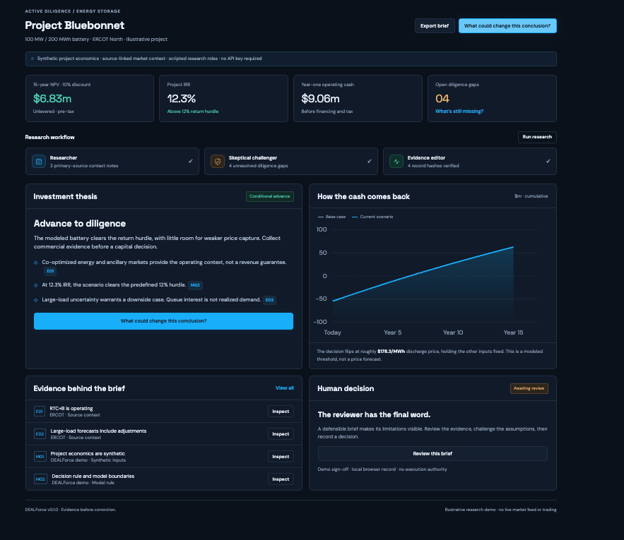

# DEALForce

**The model proposes. The reviewer decides.**

An ERCOT research workspace for examining an investment thesis, challenging its assumptions, and recording why a reviewer approves it or requests a revision.

The centerpiece is **“What could change this conclusion?”** Change load realization, discharge price, construction cost, or operating delay; deterministic calculations update the brief and invalidate any earlier sign-off.

## See the workflow



**Start with a thesis. Challenge its assumptions. Inspect the evidence. Record a human decision.** The fictional Bluebonnet base case shows $6.83m NPV and 12.3% IRR; the slower-build-out preset falls to −$5.14m NPV and 8.5% IRR.

[Explore the visual walkthrough](docs/visual-walkthrough.md) for the assumption controls, scenario comparison, evidence room and review surface. The [E01 source-to-claim example](docs/visual-walkthrough.md#follow-e01-from-primary-source-to-bounded-claim) pairs the ERCOT notice with the in-product evidence inspection.

*Screenshots from the working demo. Project economics are synthetic, research roles are scripted, and review records are browser-local.*

## Run locally

Requires Node.js 20+ and Python 3. No npm packages or API keys are required.

```bash
npm test
npm run build
npm start
```

Open http://localhost:8000. Static hosting serves the generated `dist/` directory. Browser cryptography requires localhost or HTTPS. Google Fonts are optional; system fonts provide a fallback.

## Optional Jackline-governed release

**A signed approval applies to one exact brief. Change an assumption, and release is blocked until the new revision is reviewed.**

The optional local Python service connects DEALForce to [Jackline](https://github.com/TAM-DS/jackline) for one protected action: release of a research document. It adds separate reviewer signatures, scoped expiring grants, server-owned revisions and persistent failure handling. The browser cannot sign or directly publish a release.

[Run the governed workflow on Mac/Linux, inspect its trust boundary, and follow the failure demonstration →](docs/governed-release.md)

The public static demo remains keyless and browser-local. The new service is an optional local mode; it is not deployed to the public demo.

## Three-minute demo

1. Open Project Bluebonnet: a **fictional** 100 MW / 200 MWh battery. Its base-case NPV is approximately **$6.83m** and IRR **12.3%**.
2. Select **What could change this conclusion?** Set large-load realization to **35%** and operating delay to **12 months**.
3. The conclusion changes to **Rework the thesis**, with NPV approximately **−$5.14m** and IRR **8.5%**.
4. Apply the scenario, inspect the evidence and outstanding diligence gaps, then record a named **Request revision** with a rationale.
5. Apply another scenario: the earlier sign-off is invalidated. Export the Markdown brief and JSON audit history.

Additional views include three fictional deal-screen fixtures, four reusable scenarios, four inspectable evidence records, and the decision history.

## What is implemented

- Navy and neon-blue responsive workspace with Researcher, Skeptical Challenger, and Evidence Editor role panels.
- Deterministic 15-year, unlevered pre-tax NPV and IRR calculations, cumulative cash chart, and threshold-price search.
- Strict numeric input bounds and build-generated SHA-256 hashes checked against each local evidence record at startup.
- Review snapshots bind the project, assumptions, evidence manifest, and model version. Changed assumptions invalidate review.
- Named approve / reject / request-revision demonstration with required rationale.
- Browser-local hash-linked audit events, Markdown brief export, and JSON audit export.
- Optional local mode: 17 Python integration tests for signed releases and failure handling, plus a Chromium workflow check. CI tests Python 3.11 and 3.13.
- Nine automated tests for model arithmetic, downside behavior, timing, costs, degradation, threshold boundaries, invalid inputs, audit modifications and review staleness. GitHub Actions runs tests and the static build.

## Honest demo boundaries

**This version is a working interaction and governance prototype, not a live multi-agent research service.** The three research roles execute a scripted demonstration. No LLM or market-data API is called. No trade, email, or other external action can be executed.

All projects, project economics and load-realization scenarios are synthetic. The two ERCOT links provide market context; they do not establish the commercial assumptions. The evidence hashes bind authored local records, not the authenticity or archived content of external pages.

In static mode, reviews and audit events are stored in this browser's local storage. Reviewer names are not authenticated. A local user can rewrite an entire hash chain, remove its tail, change the code, or clear storage. This is **not a production authorization boundary or tamper-proof audit system**. Production use needs server-enforced identity, snapshot authorization, immutable external audit anchoring, source ingestion and access controls. These limitations describe static mode. The optional Jackline service adds a separate, server-enforced document-release workflow with key-verified decisions; its single-host trust boundary and remaining production requirements are documented in [governed release](docs/governed-release.md).

## Model contract

The base Bluebonnet fixture assumes $55m upfront capex, $180/MWh discharge price, $35/MWh charging price, $1.2m annual ancillary revenue, and $1.6m annual operating cost. Other fictional projects specify their own capex and price inputs in `web/model.mjs`.

- Annual discharged MWh: `200 × 365 × 0.93 × 0.98^(year−1)`.
- Effective discharge price: `price + (realization − 60) × 0.60`.
- Annual operating cash ($m): `discharged MWh × (effective price − charging price / 0.86) / 1e6 + ancillary − opex`.
- NPV: capex paid today, then 15 annual cash flows discounted at 10%, at times `year + delay / 12`.
- IRR: bracketed bisection on the same dated cash flows. Returns unavailable if the supported positive-flow assumptions do not hold.
- Advance only if NPV is nonnegative **and** IRR is at least 12%.

The $0.60 load-to-price sensitivity is hypothetical, not a fitted causal relationship or a forecast. A delay shifts cash timing without adding construction cost. The model excludes taxes, debt, augmentation, nodal congestion, curtailment and optimized dispatch. Ancillary and energy revenue stacking requires commercial validation. The plotted cumulative cash is undiscounted.

## Evidence

`web/evidence.json` contains two analyst-authored source paraphrases and two synthetic/model records. `scripts/build.mjs` hashes each JSON record into the deployed manifest. `web/app.mjs` checks those hashes before rendering the workspace. Changing both the evidence and its manifest remains possible; no independent attestation is implied.

Primary context sources, reviewed November 25, 2026:

- [ERCOT RTC+B operating notice](https://www.ercot.com/services/comm/mkt_notices/M-F110525-04)
- [ERCOT load forecasts](https://www.ercot.com/gridinfo/load/forecast)

## Project layout

- `web/model.mjs`: pure calculation and screening rules.
- `web/audit.mjs`: canonical snapshots and local hash-chain utilities.
- `web/app.mjs`: workspace interactions and exports.
- `web/styles.css`: responsive visual design.
- `tests/core.test.mjs`: arithmetic and state-integrity checks.
- `governed/`: local backend, reviewer CLI and Jackline release adapter.
- `web/release.mjs`: optional governed-release interface.
- `tests/test_governed.py`: signed release, failure and HTTP boundary integration checks.
- `tests/browser_smoke.py`: browser workflow and static-mode regression checks.

Licensed under Apache 2.0. Research demonstration only; not an investment recommendation.
