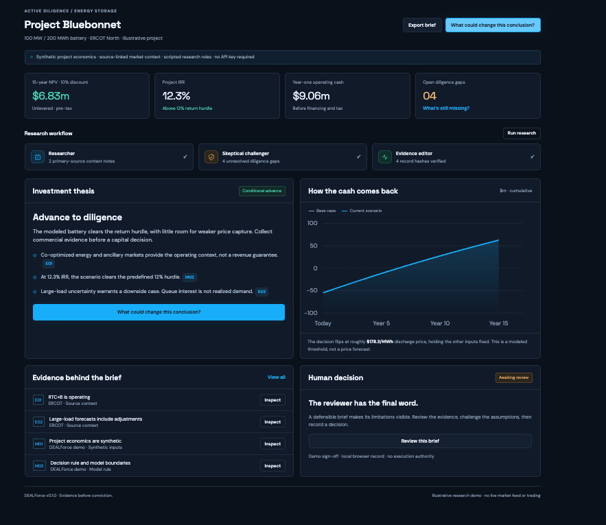
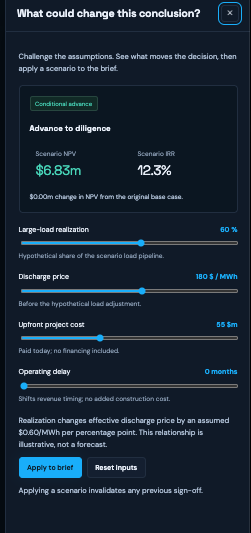
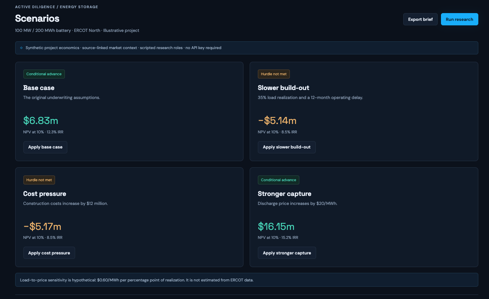
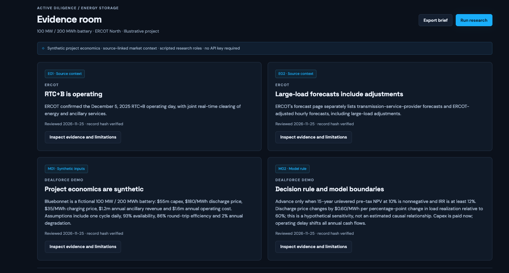
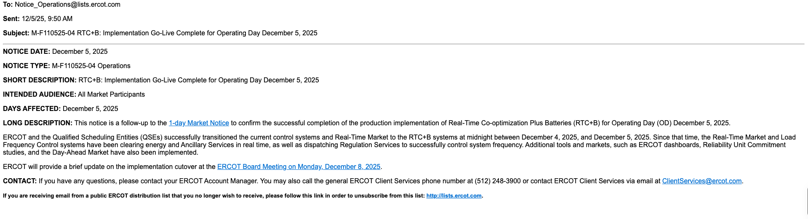
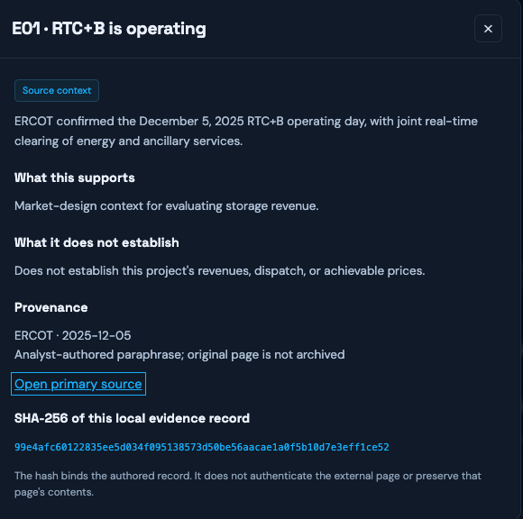

# DEALForce visual walkthrough

[Back to the project README](../README.md)

These screenshots show the research and review workflow in the working demo, including an ERCOT source capture paired with its in-product evidence record. All project economics are synthetic; the research roles are scripted. They illustrate the interface, not live research execution or production authorization.

## Start with a reviewable thesis



Bluebonnet clears the illustrative screening hurdle. Its metrics, conclusion, evidence links and unresolved diligence gaps appear together, with the human decision still pending.

## Ask what could change the conclusion



The drawer exposes four assumptions and updates scenario NPV and IRR as they change. This capture shows the base-case inputs: 60% load realization, $180/MWh discharge price, $55m upfront cost and no operating delay. Applying a scenario invalidates any previous sign-off.

## Compare the consequences



The slower-build-out preset explicitly changes load realization to 35% and delays operations by 12 months. NPV moves from **$6.83m to −$5.14m**, and IRR from **12.3% to 8.5%**, below the 12% screening hurdle. The cost and price scenarios expose other ways the thesis can change.

The load-to-price relationship is a hypothetical sensitivity, not an estimated causal relationship or an ERCOT forecast.

## Inspect what supports the brief



Source context, synthetic inputs and decision rules are labeled separately. Reviewers can inspect each record and its limitations. Record hashes bind the local authored content; they do not independently authenticate external pages.

## Follow E01 from primary source to bounded claim

### The primary-source notice

[](https://www.ercot.com/services/comm/mkt_notices/M-F110525-04)

**Source:** ERCOT, notice **M-F110525-04**, dated **December 5, 2025**. [Read the notice on ERCOT's website](https://www.ercot.com/services/comm/mkt_notices/M-F110525-04).

The notice confirms the completed RTC+B production transition and real-time clearing of energy and ancillary services. Its text was checked against the linked ERCOT page on **November 26, 2026**. The image is a user-supplied screenshot retained unchanged for this walkthrough; it is not an independently authenticated capture or a complete web archive. Source content belongs to ERCOT.

### How DEALForce uses it



The evidence panel makes the reasoning inspectable:

| Review question | What E01 provides |
| --- | --- |
| What is the claim? | RTC+B is operating, with real-time clearing of energy and ancillary services. |
| What does that support? | Market-design context for evaluating storage revenue. |
| What remains unproven? | Bluebonnet's revenues, dispatch and achievable prices. |
| Where can a reviewer check it? | The linked ERCOT notice, alongside the authored local paraphrase. |
| What does the hash bind? | The serialized local E01 JSON record, not the screenshot or external page. |

The hash visible in the evidence screenshot matches the repository's E01 record at the time this documentation was added:

```text
99e4afc60122835ee5d034f095138573d50be56aacae1a0f5b10d7e3eff1ce52
```

The demo's “original page is not archived” label refers to its runtime evidence pipeline. Adding this screenshot to repository documentation does not add source-page ingestion, cryptographic source authentication or a runtime archive. The synthetic project economics remain separate from this market-context evidence.

## Make the human decision explicit


The review surface asks for a name and rationale while keeping unresolved commercial, interconnection, operating and load-model evidence visible. This capture shows a **pending decision**, not a completed approval.

In this prototype, a named decision is an unauthenticated browser-local record. It does not authorize an investment. The README explains the controls needed for production use.
