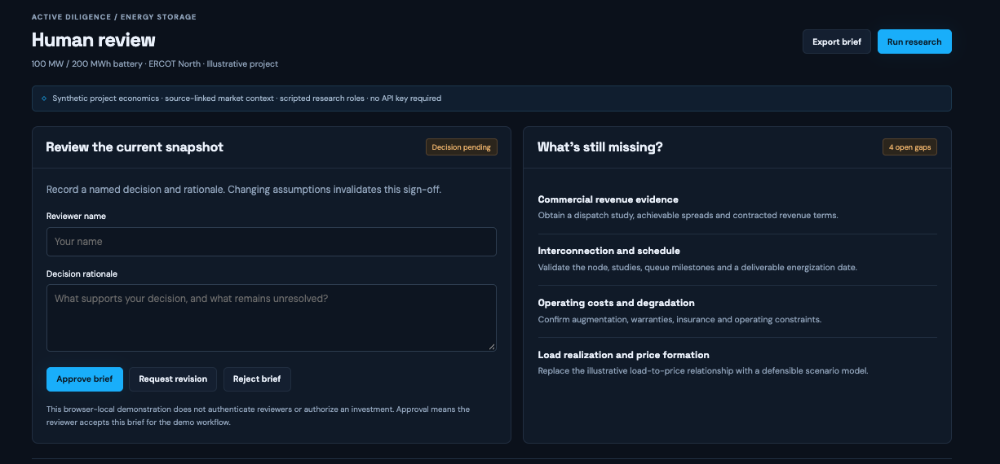

# DEALForce visual walkthrough

[Back to the project README](../README.md)

These five screenshots show the research and review workflow in the working demo. All project economics are synthetic; the research roles are scripted. They illustrate the interface, not live research execution or production authorization.

## Start with a reviewable thesis

Bluebonnet clears the illustrative screening hurdle. Its metrics, conclusion, evidence links and unresolved diligence gaps appear together, with the human decision still pending.

## Ask what could change the conclusion

The drawer exposes four assumptions and updates scenario NPV and IRR as they change. This capture shows the base-case inputs: 60% load realization, $180/MWh discharge price, $55m upfront cost and no operating delay. Applying a scenario invalidates any previous sign-off.

## Compare the consequences

The slower-build-out preset explicitly changes load realization to 35% and delays operations by 12 months. NPV moves from **$6.83m to −$5.14m**, and IRR from **12.3% to 8.5%**, below the 12% screening hurdle. The cost and price scenarios expose other ways the thesis can change.

The load-to-price relationship is a hypothetical sensitivity, not an estimated causal relationship or an ERCOT forecast.

## Inspect what supports the brief

Source context, synthetic inputs and decision rules are labeled separately. Reviewers can inspect each record and its limitations. Record hashes bind the local authored content; they do not independently authenticate external pages.

## Make the human decision explicit

The review surface asks for a name and rationale while keeping unresolved commercial, interconnection, operating and load-model evidence visible. This capture shows a **pending decision**, not a completed approval.

In this prototype, a named decision is an unauthenticated browser-local record. It does not authorize an investment. The README explains the controls needed for production use.
